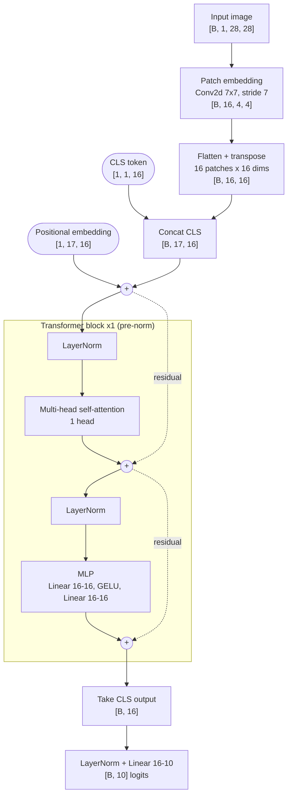
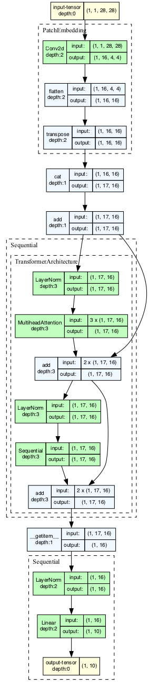
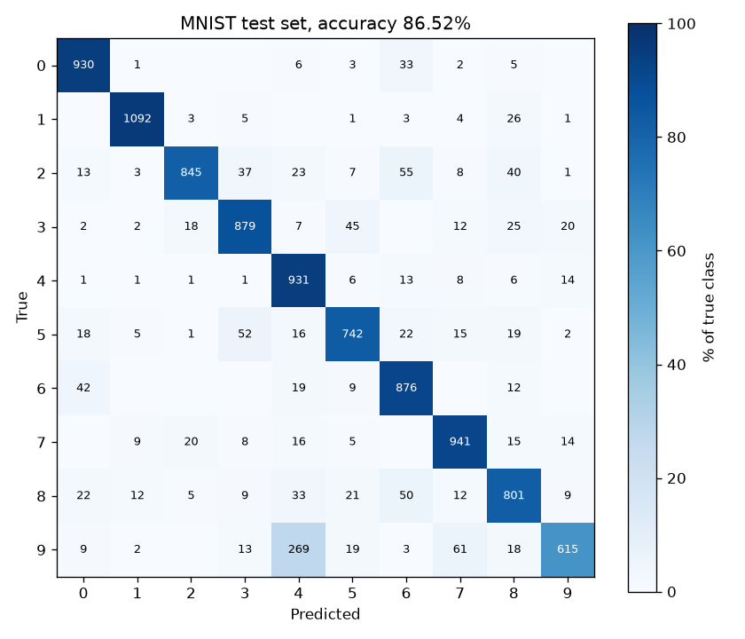

# Vision Transformer from scratch (MNIST)

A minimal Vision Transformer (ViT) in PyTorch, trained on MNIST. The notebook walks through
the architecture step by step; the `vit` package trains, exports and benchmarks the same model.

## Architecture



Layer graph generated from the model with torchview (`make diagram`):



| Stage | Output shape |
|---|---|
| Input | `[B, 1, 28, 28]` |
| Patch embedding (Conv2d 7x7, stride 7) | `[B, 16, 4, 4]` |
| Flatten + transpose (16 patches x 16 dims) | `[B, 16, 16]` |
| Prepend CLS token + add positional embedding | `[B, 17, 16]` |
| Transformer block x1: `x + MHA(LN(x))`, `x + MLP(LN(x))` | `[B, 17, 16]` |
| CLS output -> LayerNorm -> Linear | `[B, 10]` |

Default config (`src/vit/config.py`): `embed_dim=16`, `num_heads=1`, `mlp_dim=16`,
`transformer_units=1`.

| Module | Parameters |
|---|---|
| Patch embedding (Conv2d) | 800 |
| CLS token | 16 |
| Positional embedding | 272 |
| Transformer block: LayerNorm x2 | 64 |
| Transformer block: self-attention | 1,088 |
| Transformer block: MLP | 544 |
| Classification head (LayerNorm + Linear) | 202 |
| **Total** | **2,986** |

## Setup

Requires [mise](https://mise.jdx.dev) (or Python 3.12) and [uv](https://docs.astral.sh/uv/).

```
mise install          # Python 3.12 from mise.toml
make setup            # uv sync: exact versions from uv.lock into .venv
make hooks            # once per clone: pre-commit hooks
```

The notebook's graph cell also needs the Graphviz binary: `brew install graphviz`.

Dependencies live in `pyproject.toml` (pinned) and `uv.lock` (full lock). Add one with
`uv add <pkg>` (or `uv add --group notebook <pkg>` / `uv add --dev <pkg>`); never `uv pip install`,
which bypasses the lockfile.

## Layout

```
pyproject.toml            deps, entry points, ruff + pytest config
uv.lock                   locked dependency versions (committed)
Makefile                  common tasks (make help)
src/vit/
  config.py               ViTConfig (model) + TrainConfig: single source of hyperparameters
  model.py                VisionTransformer, checkpoint save/load, device selection
  data.py                 MNIST datasets/loaders
  train.py                vit-train: train + export checkpoint with provenance
  infer.py                vit-infer: accuracy, latency benchmark, image prediction
notebooks/
  01_vit_from_scratch.ipynb   step-by-step tutorial + visualizations
tests/                    model, inference CLI, notebook/package parity
scripts/                  pre-commit helper + architecture diagram renderer
docs/architecture.png     layer graph (make diagram)
docs/confusion_matrix.png confusion matrix heatmap (make bench)
results/bench.json        latest benchmark (committed)
checkpoints/ data/ samples/   generated, gitignored
```

The notebook intentionally keeps its own inline model classes as a from-scratch tutorial.
`tests/test_notebook_parity.py` checks its hyperparameters match `ViTConfig` and that its
weights load into `vit.VisionTransformer` with identical outputs, so the two cannot drift.

## Common tasks

```
make help
make test                 # pytest (~6s, CPU only, no dataset download)
make lint                 # ruff check + format check
make format               # auto-fix
make notebook             # jupyter lab notebooks/
make train                # -> checkpoints/vit_mnist.pt
make train TRAIN_ARGS="--epochs 10 --lr 1e-3" CHECKPOINT=checkpoints/run2.pt
make bench                # cpu + mps accuracy, confusion matrix, latency -> results/bench.json
make samples              # 10 MNIST test digits -> samples/
make diagram              # docs/architecture.png
```

Or call the entry points directly (`uv run vit-train --help`, `uv run vit-infer --help`):

```
uv run vit-infer --device cpu --device mps --batch-sizes 1,32 --iters 500
uv run vit-infer --image samples/*.png
uv run vit-infer --image photo.png --invert     # dark digit on light background
```

Images are converted to grayscale and resized to 28x28. MNIST digits are white on black,
so use `--invert` for dark-on-light images. MNIST downloads to `./data` on first use.

## Reproducibility

- Training is seeded (`--seed`, default 0); the same seed + lockfile gives identical results.
- Each checkpoint stores the model config, training config, per-epoch history, final
  `val_acc`, git SHA (`-dirty` if uncommitted changes), torch version, device and timestamp.
- `make bench` writes `results/bench.json` with the machine, torch version, checkpoint SHA and
  per-device accuracy and latency. Commit it when results change.

## Test results

`make test`: 23 passed in ~5s (CPU only, no dataset download).

| Test | What it checks | Result |
|---|---|---|
| `test_output_shape[1, 7, 64]` | Logits are `[B, 10]` for several batch sizes | Pass |
| `test_param_count_is_stable` | Exactly 2,986 parameters (catches accidental architecture changes) | Pass |
| `test_config_drives_architecture` | Non-default `ViTConfig` (embed 32, 4 heads, 3 layers) builds and runs | Pass |
| `test_checkpoint_round_trip` | Save + load gives bit-identical outputs and keeps metadata | Pass |
| `test_training_provenance_is_weights_only_loadable` | Training metadata loads with `torch.load(weights_only=True)` | Pass |
| `test_overfits_single_batch` | Model + loss + optimizer can memorize one batch (loss under 0.05) | Pass |
| `test_predict_image` | Image file prediction returns a digit and confidence | Pass |
| `test_latency_summary` | Benchmark summary has p50/p95/throughput fields | Pass |
| `test_cli_predicts_images` | `vit-infer --image` end to end | Pass |
| `test_cli_missing_image_exits_cleanly` | Missing image gives a clear error, not a traceback | Pass |
| `test_cli_missing_checkpoint_exits_cleanly` | Missing checkpoint gives a clear error | Pass |
| `test_entry_point_installed` | `python -m vit.infer --help` works | Pass |
| `test_notebook_hyperparameters_match_config` | Notebook globals equal `ViTConfig` defaults | Pass |
| `test_notebook_weights_load_into_package_model` | Notebook model weights load into the package model with identical outputs | Pass |
| `test_confusion_matrix_counts` | Hand-checked 3-class matrix; diagonal sum equals correct predictions | Pass |
| `test_confusion_matrix_includes_unseen_classes` | Always 10x10 even if some classes never appear | Pass |
| `test_per_class_metrics` | Precision / recall / F1 against hand-computed values | Pass |
| `test_per_class_metrics_handles_empty_class` | No division by zero for classes with no samples | Pass |
| `test_top_confusions_ignores_correct_predictions` | Ranks off-diagonal mistakes only | Pass |
| `test_save_confusion_png` | Heatmap is written as a valid PNG | Pass |
| `test_evaluate_matrix_agrees_with_accuracy` | `evaluate()` matrix rows match label counts and its diagonal matches accuracy | Pass |

## Performance

Measured on Apple M3 Pro, macOS, torch 2.14.1. Raw numbers: `results/bench.json`
(regenerate with `make train && make bench`).

### Training (`make train` defaults: 5 epochs, Adam lr 0.01, batch 64, seed 0, MPS)

| Epoch | Train loss | Train acc | Test acc |
|---|---|---|---|
| 1 | 0.864 | 69.53% | 78.97% |
| 2 | 0.614 | 78.70% | 82.70% |
| 3 | 0.538 | 81.78% | 84.53% |
| 4 | 0.471 | 84.59% | 84.57% |
| 5 | 0.430 | 86.24% | 86.52% |

~5-6s per epoch, ~30s total. Checkpoint size ~20 KB.

### Inference

Test accuracy: **86.52%** (10,000 MNIST test images, identical on CPU and MPS).
Full test set: ~0.33s on CPU, ~0.28s on MPS, including data loading.

| Batch | CPU p50 | CPU p95 | CPU img/s | MPS p50 | MPS p95 | MPS img/s |
|---|---|---|---|---|---|---|
| 1 | 0.13 ms | 0.14 ms | ~7.6k | 0.50 ms | 0.64 ms | ~2.0k |
| 64 | 1.40 ms | 1.47 ms | ~46k | 0.53 ms | 0.59 ms | ~121k |
| 256 | 5.15 ms | 6.33 ms | ~50k | 0.47 ms | 0.66 ms | ~539k |
| 1024 | 19.6 ms | 20.7 ms | ~52k | 0.87 ms | 1.14 ms | ~1.17M |

- Single-image latency: CPU wins (~4x), since MPS dispatch overhead dominates a model this small.
- Batched throughput: MPS wins (~22x at batch 1024); CPU saturates around ~50k img/s.

### Confusion matrix

`make bench` also computes the confusion matrix on the 10,000 test images (identical on CPU and
MPS) and saves `docs/confusion_matrix.png`. Cell color = % of the true class, numbers = counts.



| Class | Precision | Recall | F1 | Support |
|---|---|---|---|---|
| 0 | 89.68% | 94.90% | 92.22% | 980 |
| 1 | 96.89% | 96.21% | 96.55% | 1135 |
| 2 | 94.62% | 81.88% | 87.79% | 1032 |
| 3 | 87.55% | 87.03% | 87.29% | 1010 |
| 4 | 70.53% | 94.81% | 80.89% | 982 |
| 5 | 86.48% | 83.18% | 84.80% | 892 |
| 6 | 83.03% | 91.44% | 87.03% | 958 |
| 7 | 88.52% | 91.54% | 90.00% | 1028 |
| 8 | 82.83% | 82.24% | 82.53% | 974 |
| 9 | 90.98% | 60.95% | 73.00% | 1009 |

Top confusions (true to predicted): 9 to 4 (269), 9 to 7 (61), 2 to 6 (55), 5 to 3 (52),
8 to 6 (50).

- **9 to 4 dominates**: 269 of 1,348 errors (20%). It is why class 9 has the lowest recall
  (61%) and class 4 the lowest precision (71%). With 7x7 patches and a single attention layer,
  the model struggles to tell a closed loop (9) from an open top (4).
- 1 and 0 are the easiest classes (F1 over 92%); 9, 4 and 8 the hardest.
- The confusion matrix, per-class metrics and top confusions are also stored per device in
  `results/bench.json`.

## Known limitations

Training at `lr=0.01` is unstable: unseeded notebook runs have ranged from ~51% to ~90% test
accuracy. Likely improvements: AdamW 1e-3 + cosine schedule, `trunc_normal_(std=0.02)` init for
CLS/positional embeddings, input normalization, and a larger model (e.g. embed 64, 4 heads,
4-6 layers, mlp 128). A ViT this size on MNIST should reach ~97-98%.

## Contributing

Pre-commit runs ruff (lint + format) and strips notebook outputs on commit, so notebooks are
committed without outputs. Run `make test lint` before committing.
